# Hybrid Identity Lab with Active Directory and Microsoft Entra ID

## Overview

I connected my on-premises Active Directory environment to Microsoft Entra ID using Microsoft Entra Connect Sync.

This project covers preparing user sign-in names, validating the local environment, configuring Password Hash Synchronization, restricting synchronization to a dedicated organizational unit, and verifying synchronized accounts in Entra ID.

## Lab Environment

| Component | Configuration |
|---|---|
| Virtualization | VMware Workstation |
| Server operating system | Windows Server 2025 |
| Domain controller | DC01 |
| Local Active Directory domain | Ben.local |
| Entra tenant domain | BenCompany.onmicrosoft.com |
| Synchronization tool | Microsoft Entra Connect Sync |
| Selected sign-in method | Password Hash Synchronization |
| Synchronization scope | HybridSync OU |
| Test users | Jane JB. Black and John JS. Smith |

For this home lab, Entra Connect Sync was installed on DC01.

## 1. Review the Existing Server Environment

I started with an existing Windows Server environment running Active Directory Domain Services and DNS.

Server Manager showed the server name, domain membership, network configuration, and installed roles.

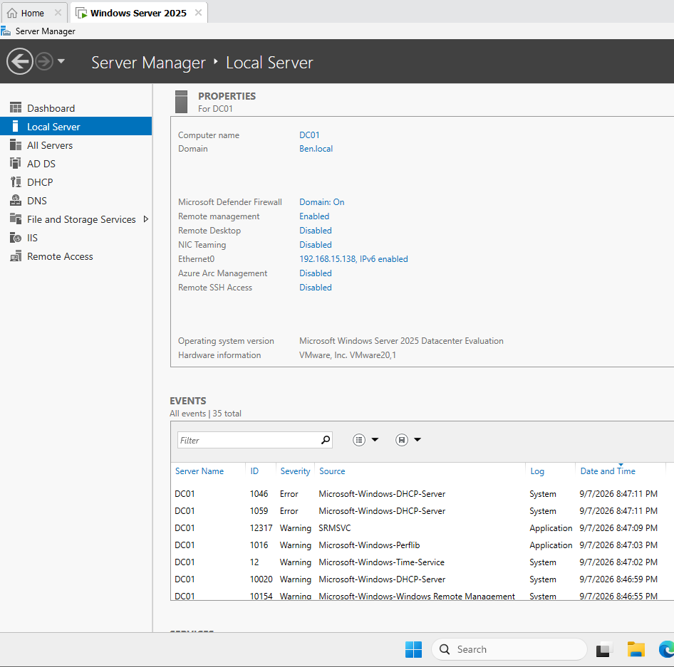

## 2. Add an Alternate UPN Suffix

The local AD domain was named `Ben.local`.

I used Active Directory Domains and Trusts to add the following alternate User Principal Name (UPN) suffix:

`BenCompany.onmicrosoft.com`

This allowed users to have sign-in names matching the Entra tenant domain while keeping the existing local AD domain.

For example:

| Sign-in name | UPN suffix |
|---|---|
| jblack@Ben.local | Ben.local |
| jblack@BenCompany.onmicrosoft.com | BenCompany.onmicrosoft.com |

Adding an alternate UPN suffix does not rename the AD domain or automatically create an email mailbox.

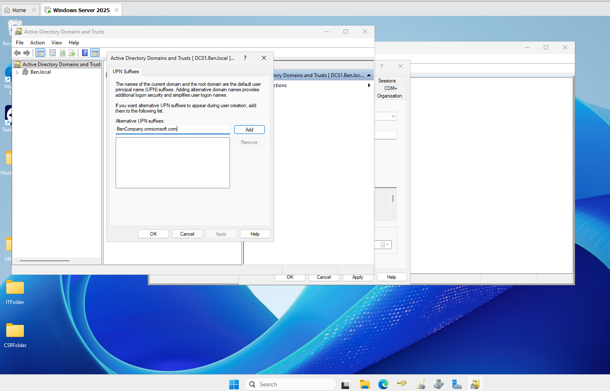

## 3. Prepare the HybridSync OU and Test Users

I created a dedicated `HybridSync` OU with child OUs for users and groups.

I placed the test users in its Users OU and assigned the tenant-matching UPN suffix.

Jane's sign-in name was configured as:

`jblack@BenCompany.onmicrosoft.com`

This provided a defined location for the identities intended for synchronization.

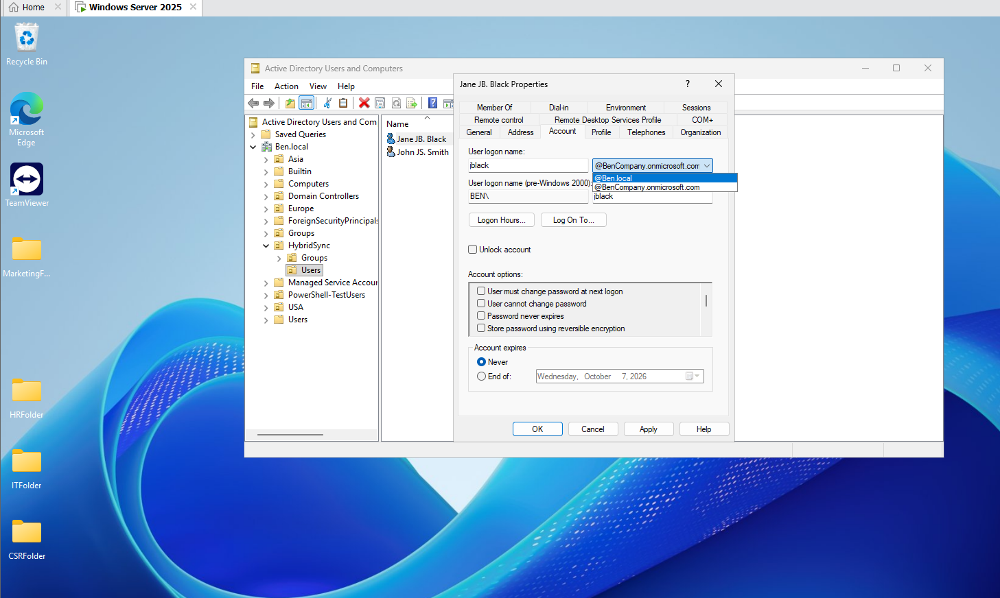

## 4. Validate the Local Environment

Before configuring synchronization, I checked the server's network configuration, DNS health, domain membership, and connectivity to Microsoft's sign-in endpoint.

### Network Configuration

I reviewed the server's network settings using:

```cmd
ipconfig /all
```

The output showed the hostname, primary DNS suffix, IP address, default gateway, and DNS servers.

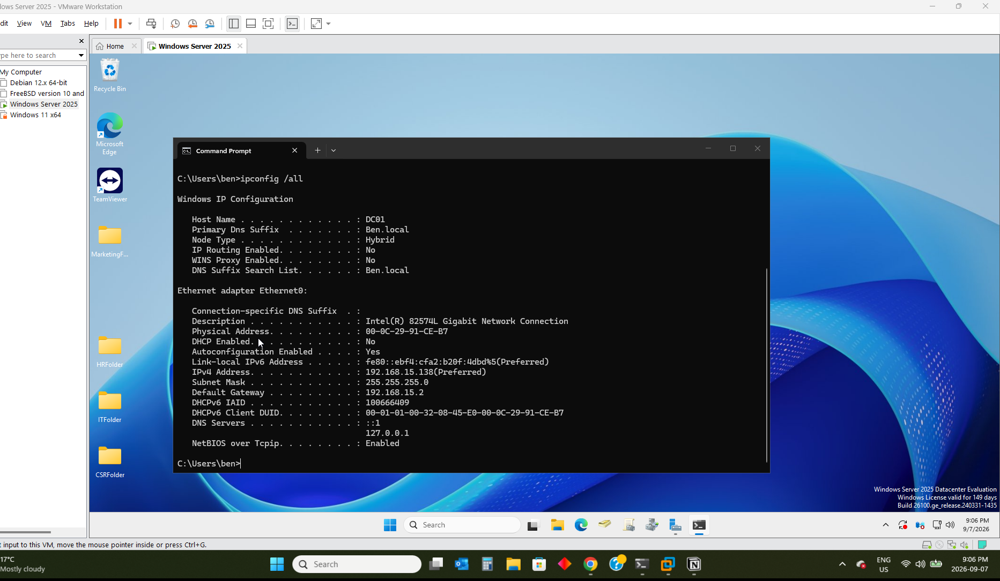

### DNS Health

I ran the following diagnostic:

```powershell
dcdiag /test:dns
```

The displayed results showed that DC01 and Ben.local passed the DNS tests.

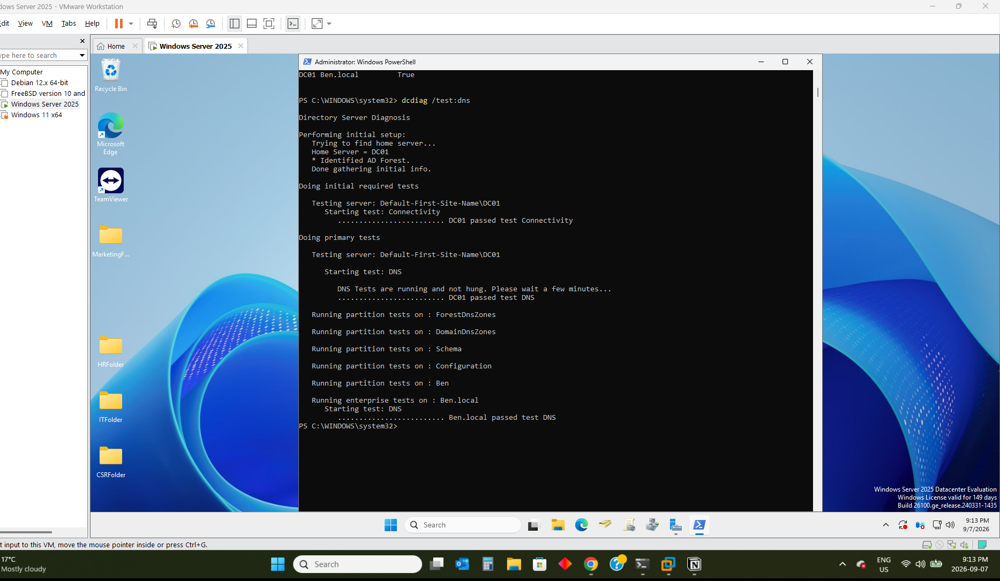

### Domain Membership and Current Account

I checked the hostname, signed-in account, and domain membership:

```powershell
hostname
whoami

Get-CimInstance Win32_ComputerSystem |
    Select-Object Name, Domain, PartOfDomain
```

The output confirmed that the server was named `DC01`, belonged to `Ben.local`, and reported `PartOfDomain` as `True`.

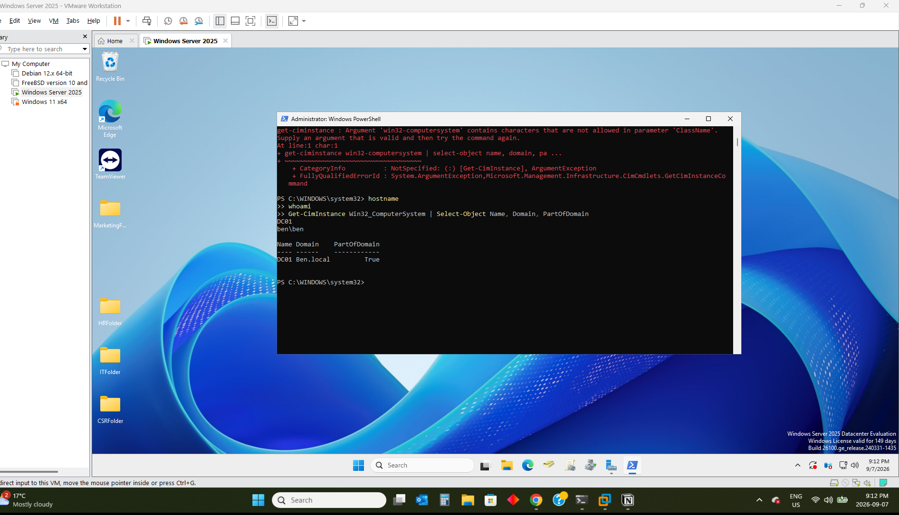

### Microsoft Endpoint Connectivity

I tested outbound TCP connectivity to Microsoft's sign-in endpoint on port 443:

```powershell
Test-NetConnection login.microsoftonline.com -Port 443
```

The result returned:

```text
TcpTestSucceeded : True
```

This confirmed connectivity to that endpoint as a preliminary network check. It did not validate every endpoint required by Entra Connect.

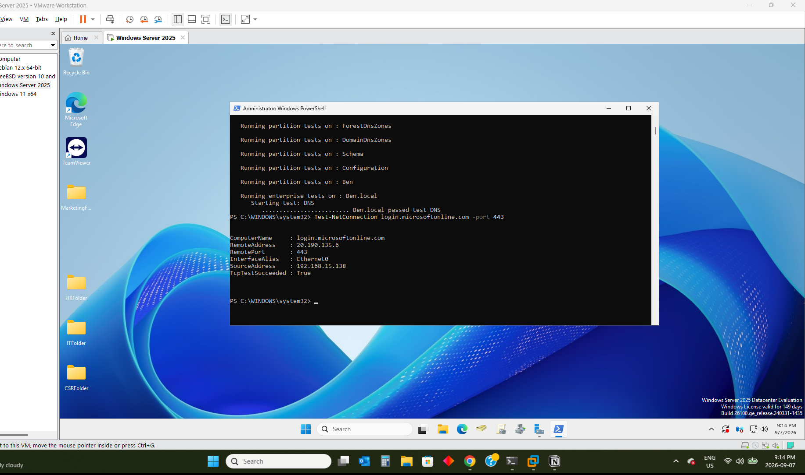

## 5. Download and Install Entra Connect Sync

I located the Connect Sync download option in the Microsoft Entra admin center.

This lab used **Entra Connect Sync**, rather than the separate Cloud Sync provisioning agent.

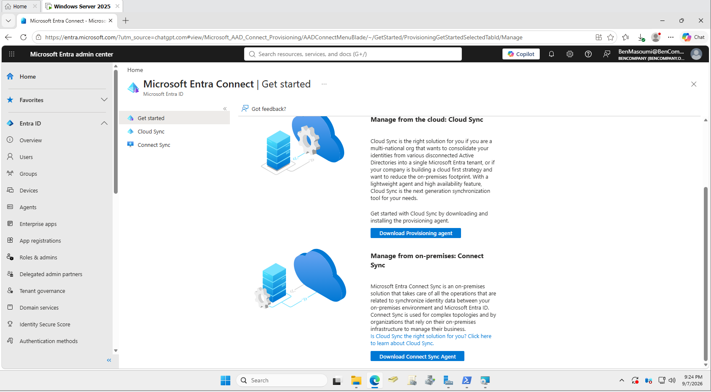

I launched the installer and proceeded through the custom configuration workflow, installing the required components.

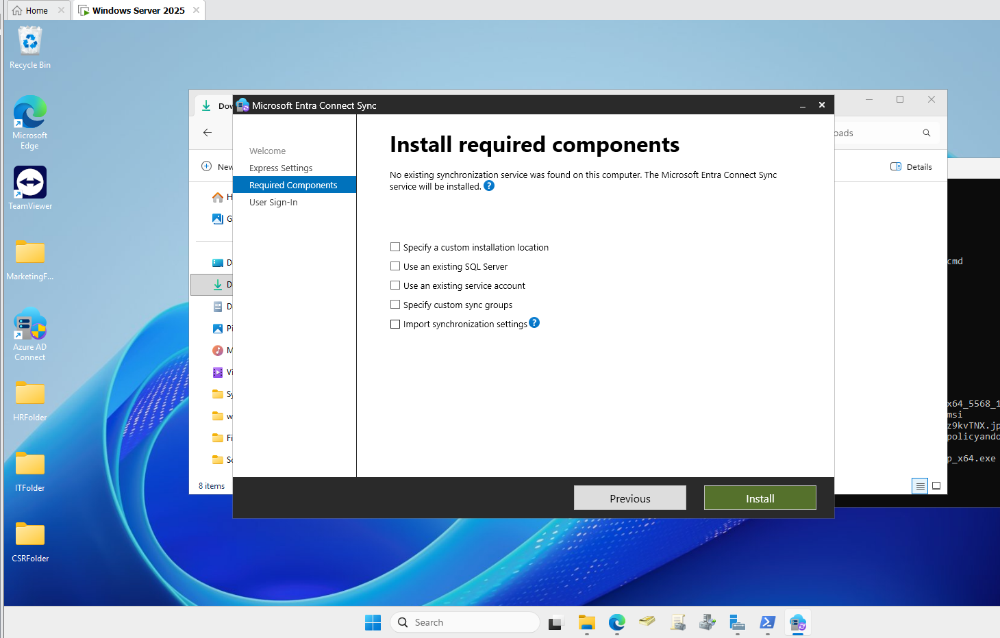

## 6. Select Password Hash Synchronization

I selected **Password Hash Synchronization (PHS)** as the sign-in method.

The separate **Enable single sign-on** option was left unchecked in this lab.

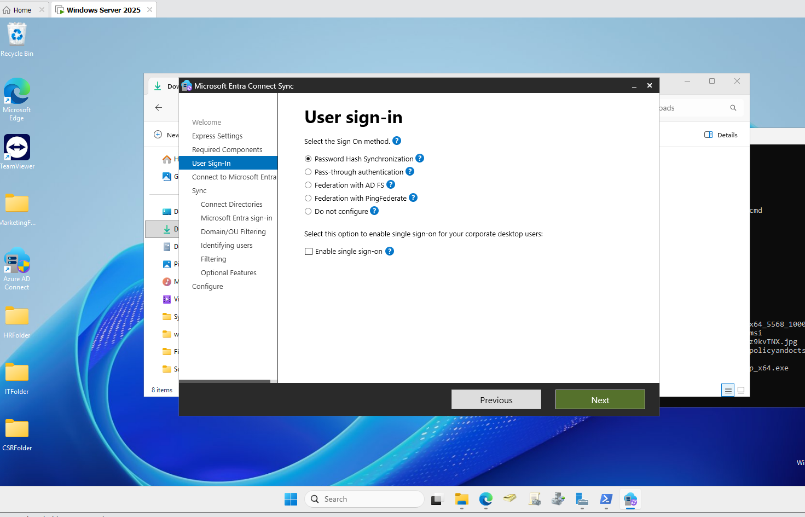

## 7. Connect the Local Directory

I selected the existing `Ben.local` forest and added it to the Entra Connect configuration.

This configured the local directory connection used by the synchronization service.

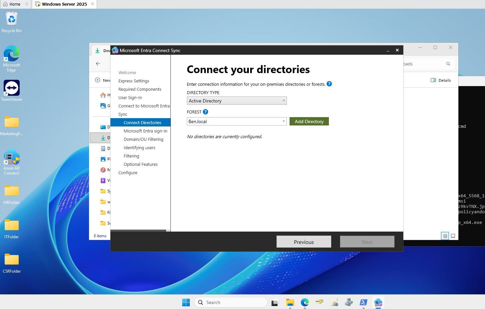

## 8. Configure OU Filtering

In the Domain and OU filtering step, I selected:

**Sync selected domains and OUs**

I included the `HybridSync` OU and left the other displayed OUs outside the selected synchronization scope.

This limited synchronization to the intended lab objects instead of including the entire directory.

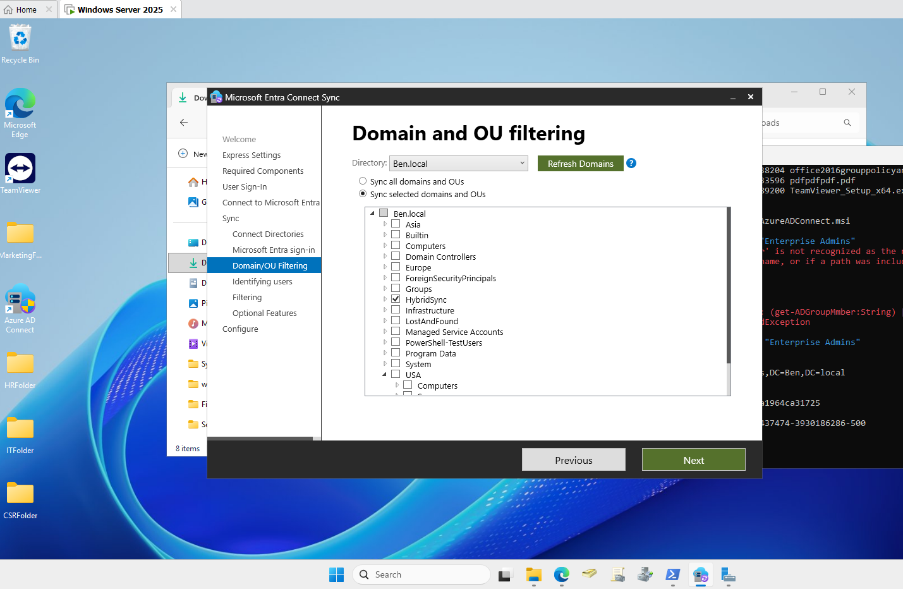

## 9. Review and Apply the Configuration

Before applying the configuration, I reviewed the summary.

It included:

- A connector for the local Ben.local directory.
- A connector for the BenCompany Entra tenant.
- Password Hash Synchronization.
- An export deletion threshold of 500.
- Synchronization starting after configuration completed.

Staging mode was left disabled.

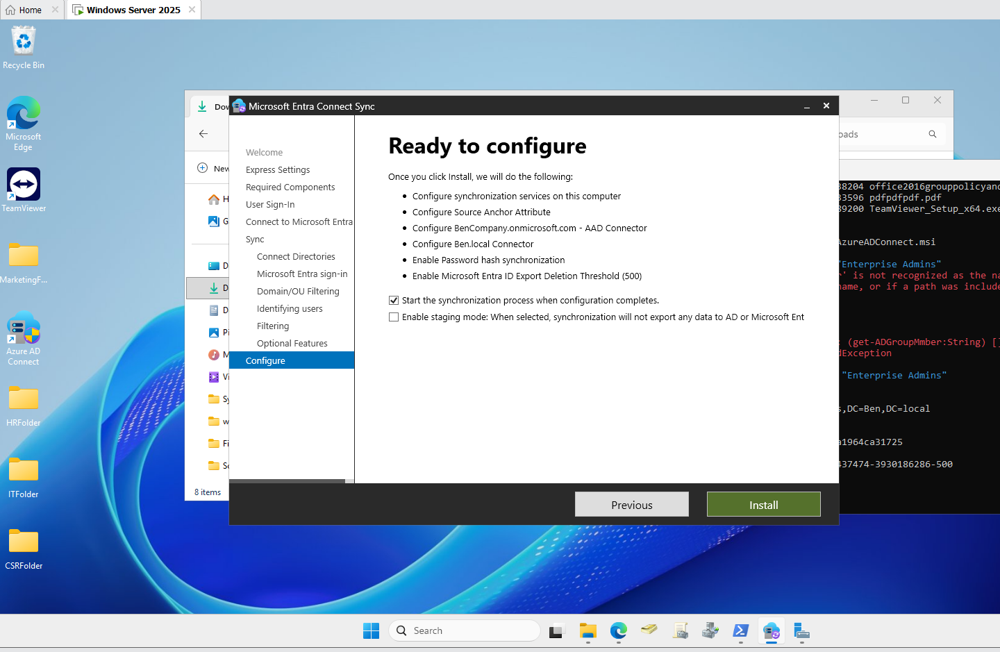

The wizard reported that configuration succeeded and the synchronization process had been initiated.

It also displayed recommendations concerning the AD Recycle Bin and TPM configuration. These remained follow-up items.

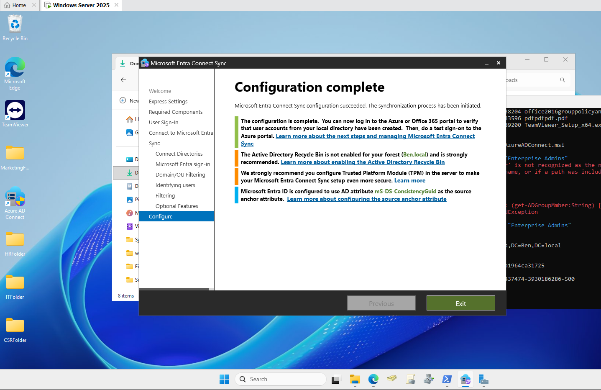

## 10. Verify Synchronized Users in Entra ID

After the initial synchronization, I checked the Entra user list.

Both test accounts appeared with **On-premises sync** set to **Yes**:

| Test user | On-premises sync |
|---|---|
| Jane JB. Black | Yes |
| John JS. Smith | Yes |

This confirmed that the two local AD identities had synchronized to Microsoft Entra ID.

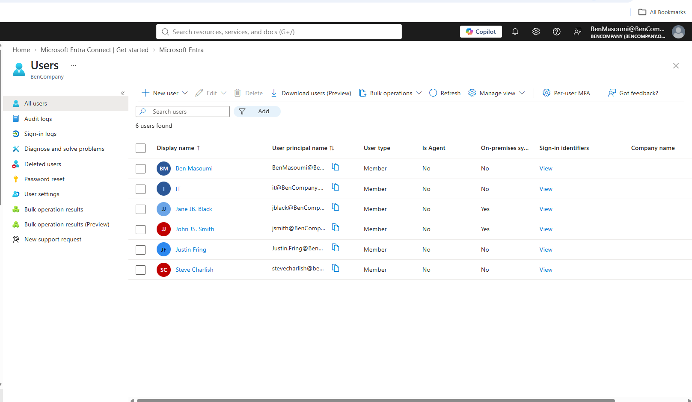

## 11. Inspect Synchronization Service Manager

I opened Synchronization Service Manager to inspect the directory connectors and synchronization details.

The interface showed connectors for the local Active Directory environment and the Entra tenant.

The displayed delta synchronization operation reported a status of `success`, with no flow errors shown for that operation.

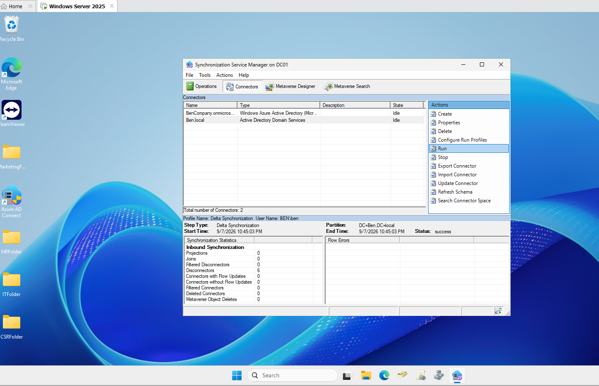

## Results

| Objective | Observed outcome |
|---|---|
| Prepare user sign-in names | Alternate UPN suffix added and assigned to test users |
| Review network configuration | Server IP, gateway, and DNS settings inspected |
| Validate DNS health | Displayed DNS tests passed |
| Verify domain membership | DC01 reported membership in Ben.local |
| Check Microsoft endpoint connectivity | TCP connection to port 443 succeeded |
| Configure Entra Connect Sync | Configuration completed successfully |
| Restrict synchronization scope | HybridSync OU selected |
| Verify synchronized identities | Both test users displayed On-premises sync = Yes |
| Inspect synchronization operations | Displayed delta synchronization reported success |

## Skills Demonstrated

- Active Directory user and OU administration.
- Alternate UPN suffix configuration.
- Microsoft Entra Connect Sync deployment.
- Password Hash Synchronization configuration.
- Domain and OU filtering.
- PowerShell verification commands.
- DNS diagnostics and TCP connectivity testing.
- Verification of synchronized cloud identities.
- Synchronization Service Manager inspection.

## Validation Scope

The screenshots document successful directory synchronization and the selected Password Hash Synchronization configuration.

Successful cloud sign-in, password-change propagation, and subsequent attribute-update tests are not documented in this project.

This lab focuses on user identity synchronization. It does not demonstrate Microsoft Entra hybrid device join.
