# Windows Server IIS — Internal HR & IT Portals with Active Directory Authentication

## Project Overview

In this project, I deployed two internal departmental websites using Internet Information Services (IIS) on Windows Server 2025.

The objective was to host separate HR and IT intranet portals on the same server, configure internal DNS resolution, and restrict access using Active Directory security groups and Windows Authentication.

Both websites use the same server IP address and HTTP port 80, with IIS hostname bindings determining which website is served.

### Project Objectives

- Host two independent internal websites using IIS.
- Configure internal DNS A records for both portals.
- Configure IIS hostname bindings to host multiple websites on one server.
- Integrate IIS with Active Directory using Windows Authentication.
- Restrict departmental website access using AD security groups.
- Test DNS resolution, authentication, and website accessibility from a Windows client.

## Lab Environment

| Component | Configuration |
|---|---|
| Hypervisor | VMware Workstation |
| Server OS | Windows Server 2025 Datacenter Evaluation |
| Client OS | Windows 11 |
| Domain Controller | DC01 |
| AD Domain | bendomain.local |
| Server IP | 192.168.15.143 |
| Web Server | IIS 10 |
| Authentication | Windows Authentication |
| Authorization | AD Security Groups / IIS URL Authorization |
| Web Protocol | HTTP (Port 80) |


## 1. Active Directory Security Groups

I used existing Active Directory security groups to manage access to the internal websites.

The domain contains departmental security groups, including:

- **SG-HR** — Human Resources employees
- **SG-IT** — Information Technology employees
- **SG-Finance** — Finance employees

These groups allow website access permissions to be managed through group membership instead of configuring individual user accounts in IIS.

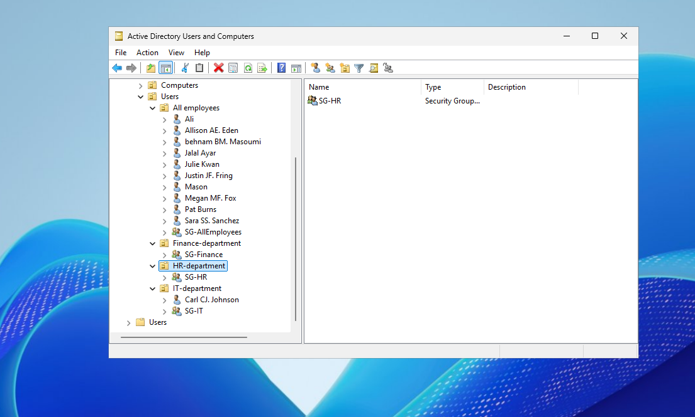

I also verified that the HR security group contained the appropriate employee accounts.

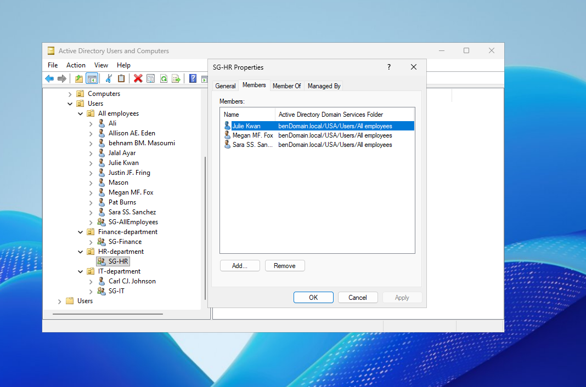

## 2. Installing IIS and Required Role Services

I installed and configured Internet Information Services (IIS) on Windows Server 2025.

The following IIS components were used:

| Role Service | Purpose |
|---|---|
| Web Server (IIS) | Hosts the internal websites |
| Windows Authentication | Authenticates users through Active Directory |
| URL Authorization | Controls access to websites based on users and groups |

I verified that these components were installed using PowerShell:

```powershell
Get-WindowsFeature Web-Server, Web-Windows-Auth, Web-Url-Auth
```

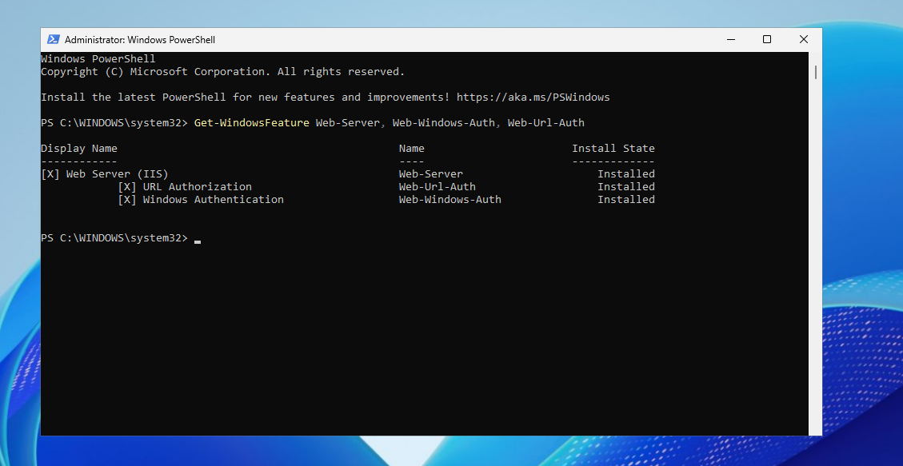

## 3. Creating the HR and IT Websites

I configured two separate websites in IIS Manager.

Each website has its own physical directory containing HTML content and its own IIS configuration.

| Website | Hostname | Port |
|---|---|---|
| HR Portal | hr.bendomain.local | 80 |
| IT Portal | it.bendomain.local | 80 |

Both websites run on the same Windows Server but are treated as separate IIS sites.

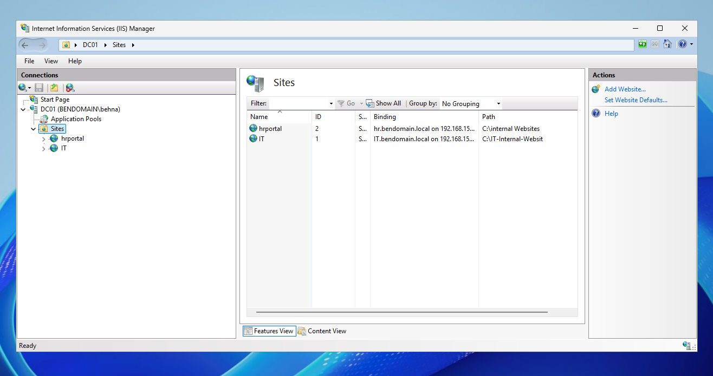

### Configuring Hostname Bindings

I configured an HTTP binding for each website using its corresponding internal hostname.

Both websites use port 80. IIS identifies the requested website using the hostname included in the HTTP request.

**HR Portal Binding**

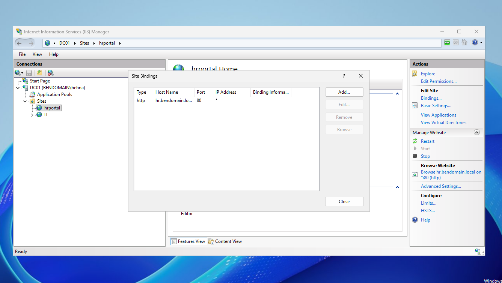

**IT Portal Binding**

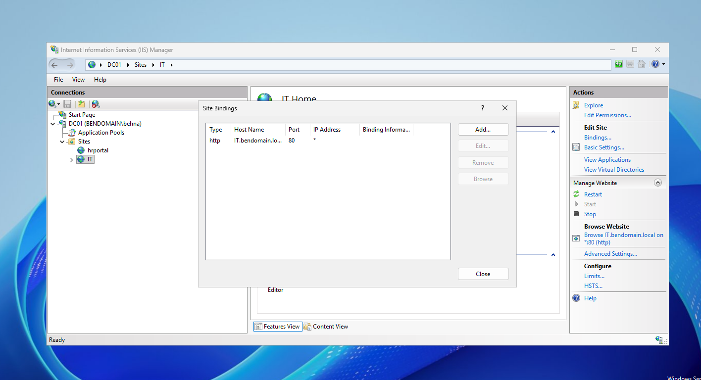

This configuration allows multiple websites to share a single server IP address without assigning a separate port to each site.

## 4. Internal DNS Configuration

To allow domain clients to access the websites using hostnames, I configured DNS A records in the `bendomain.local` forward lookup zone.

| DNS Record | IP Address |
|---|---|
| hr.bendomain.local | 192.168.15.143 |
| it.bendomain.local | 192.168.15.143 |

Both records point to the same IIS server.

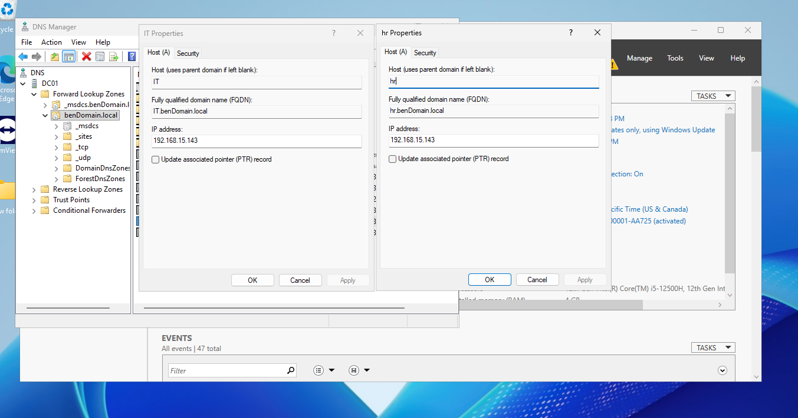

### Testing DNS Resolution

I verified name resolution using `nslookup`:

```cmd
nslookup hr.bendomain.local
nslookup it.bendomain.local
```

Both queries returned the expected server address, `192.168.15.143`.

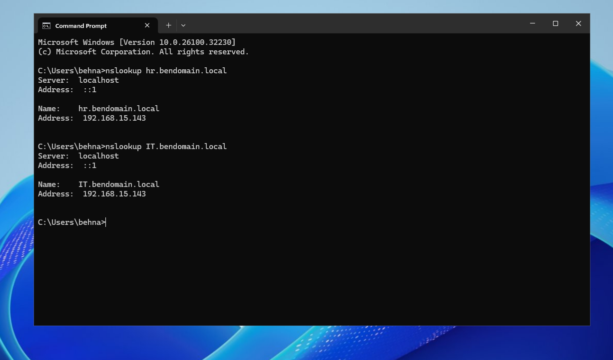

DNS resolves each hostname to the server IP address, while IIS uses the hostname binding to direct HTTP requests to the appropriate website.

## 5. Configuring Default Documents

Each website contains its own HTML homepage.

I configured the IIS Default Document feature so users can access either website by entering only its hostname, without specifying the HTML filename.

For the HR website, I configured:

`HRPortal.html`

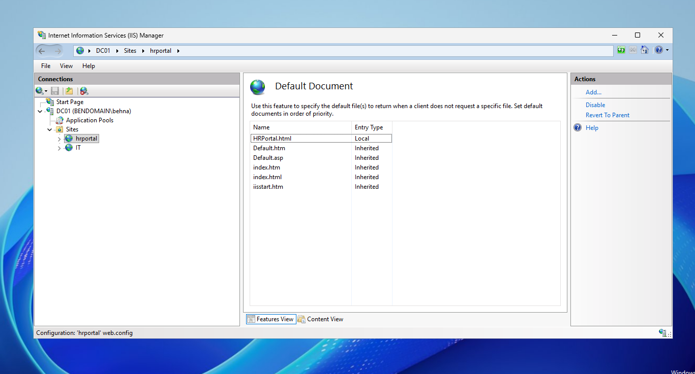

For the IT website, I configured:

`ITPortal.html`

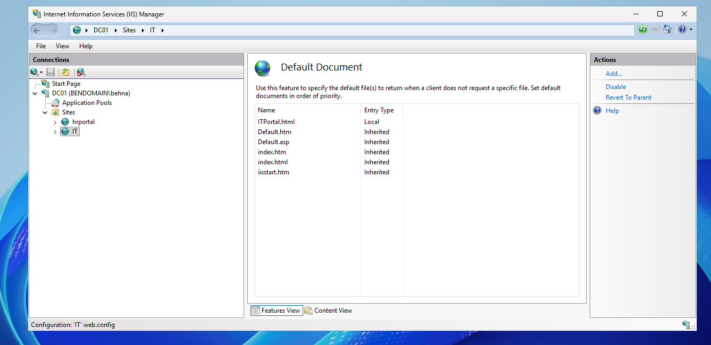

The default documents allow IIS to serve the appropriate homepage when a user requests the root URL of either site.

## 6. Configuring Windows Authentication

To integrate the websites with Active Directory authentication, I configured Windows Authentication for both IIS sites.

The authentication settings were:

| Authentication Method | Status |
|---|---|
| Anonymous Authentication | Disabled |
| Windows Authentication | Enabled |

This configuration requires users to authenticate with their Windows domain credentials before accessing the websites.

**HR Website Authentication**

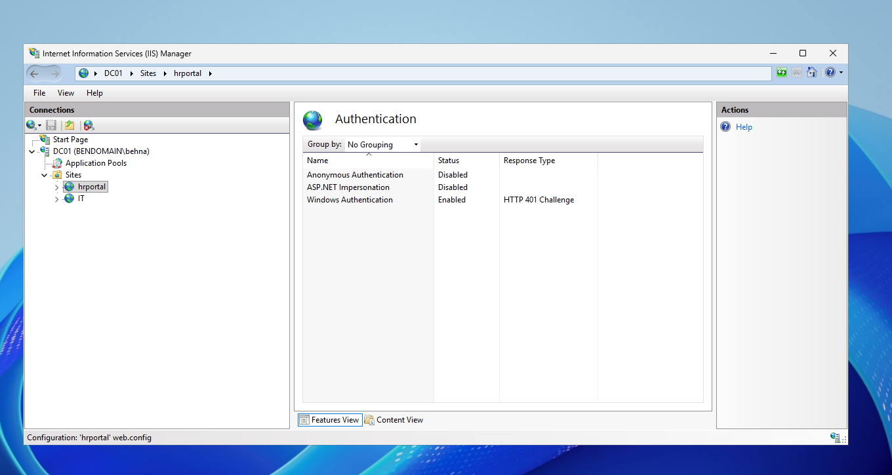

**IT Website Authentication**

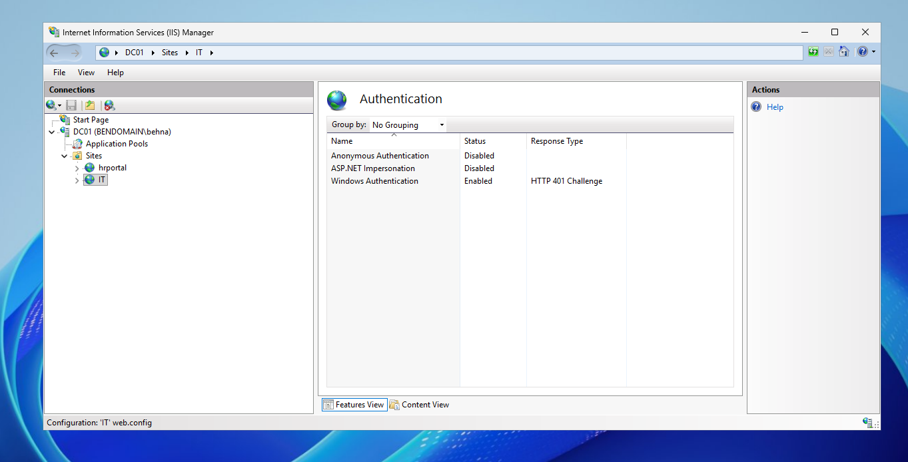

Windows Integrated Authentication also supports automatic authentication using a user's existing Windows sign-in session when the client browser is configured appropriately.

## 7. Configuring Department-Based Authorization

After enabling Windows Authentication, I configured IIS Authorization Rules to restrict access based on Active Directory security group membership.

### HR Website

The HR portal was configured to allow members of:

`BENDOMAIN\SG-HR`

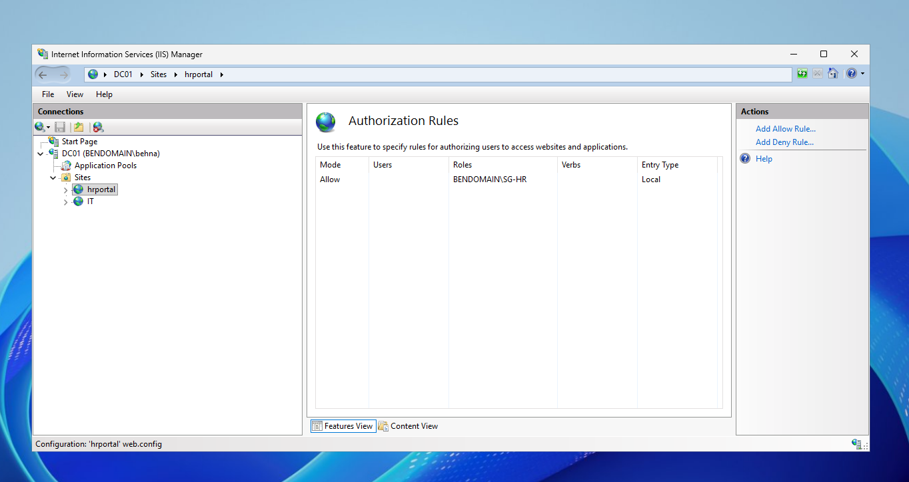

### IT Website

The IT portal was configured to allow members of:

`BENDOMAIN\SG-IT`

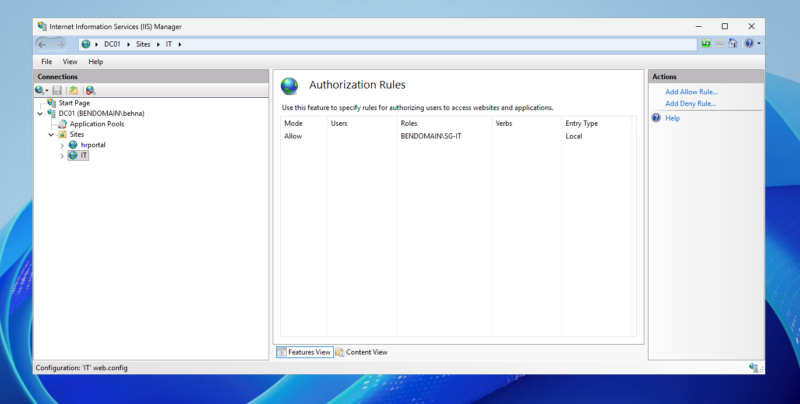

The websites use separate authorization policies, allowing departmental access to be managed centrally through Active Directory group membership.

This configuration follows the principle of least privilege by limiting website access to the designated department.

## 8. Testing Website Access

I tested the websites through Microsoft Edge on a Windows 11 virtual machine.

### HR Portal

Navigating to:

`http://hr.bendomain.local`

Successfully loaded the BenCompany HR intranet homepage.

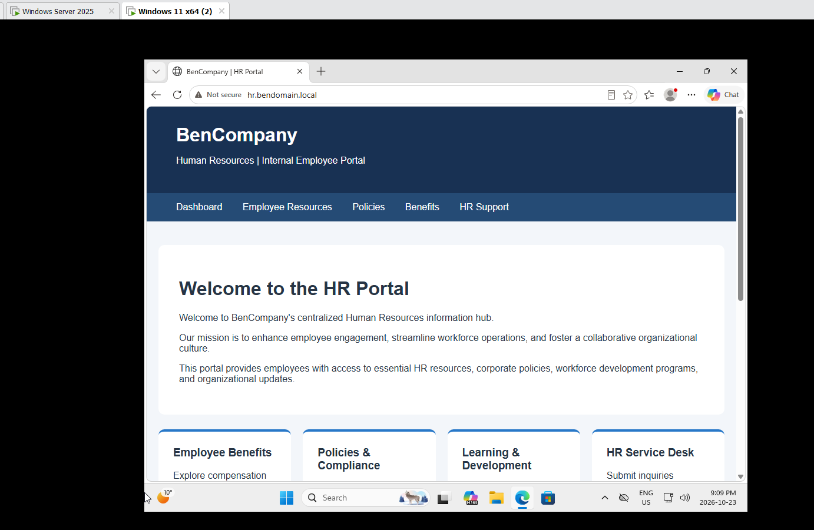

### IT Portal

Navigating to:

`http://it.bendomain.local`

Successfully loaded the BenCompany IT Operations portal.

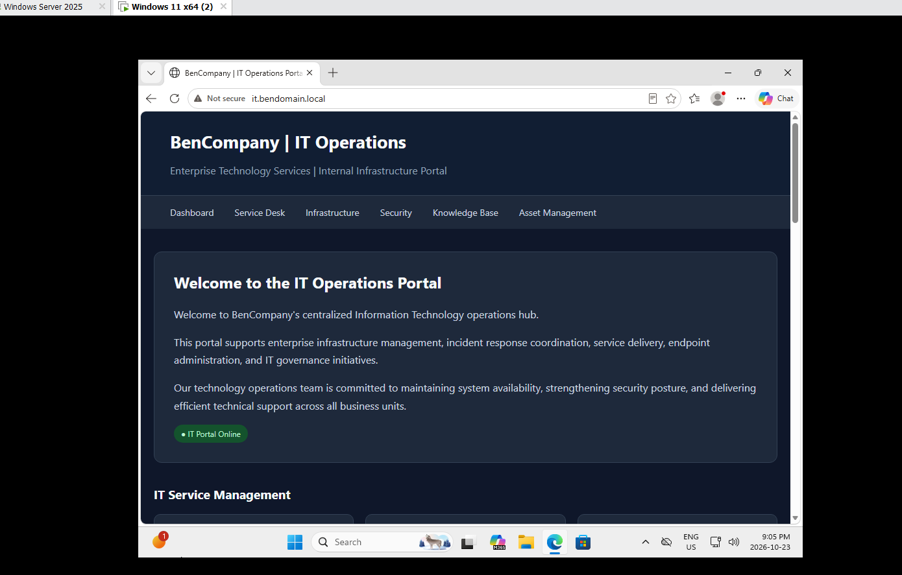

### Access Control Validation

I tested the HR portal using an account belonging to the authorized HR security group and another test account without HR group membership.

The HR account successfully loaded the website, while the unauthorized test account received an HTTP 401 response and could not access the HR homepage.

This confirmed the expected access behavior during testing, alongside the IIS authentication and authorization settings.

### Test Results

| Test | Result |
|---|---|
| HR hostname resolves through DNS | Passed |
| IT hostname resolves through DNS | Passed |
| HR website loads | Passed |
| IT website loads | Passed |
| Both websites operate on port 80 | Passed |
| Windows Authentication enabled | Verified |
| Departmental authorization rules configured | Verified |
| Authorized HR account accesses HR portal | Passed |
| Unauthorized test account accesses HR portal | Access rejected |

## 9. Security Considerations

This project was completed in an isolated virtual lab.

Both websites were configured to use HTTP on port 80 for demonstration purposes. In a production environment, HTTPS with a trusted TLS certificate would be required to protect communications, particularly for websites using Windows Authentication or handling employee information.

Additional production considerations include server patching, appropriate NTFS permissions, IIS logging, monitoring, and regular access reviews.

The HR and IT dashboards contain static demonstration content rather than live employee information or operational data.

## 10. Project Summary

Through this project, I gained practical experience deploying and managing multiple internal websites on Windows Server using IIS.

I configured DNS records, HTTP hostname bindings, default documents, Windows Authentication, and Active Directory security group-based authorization.

The project also helped reinforce how DNS, IIS, Windows authentication, and authorization policies work together to provide internal web services in a domain environment.
